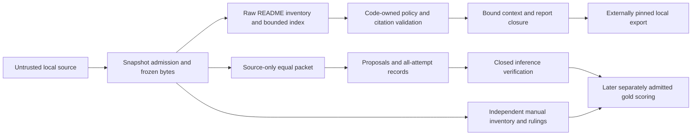

# Maintainer architecture

This map describes constructed source, not demonstrated runtime behavior. Product,
hostile-input, human/live evaluation and Action acceptance remain unperformed.
See [limitations](LIMITATIONS.md) and the [validation plan](validation-plan.md).

## Admission and static audit

[snapshot](../src/claim_auditor/snapshot/__init__.py),
[isolated Git acquisition](../src/claim_auditor/snapshot/git.py) and
[ordinary-file readers](../src/claim_auditor/snapshot/safeio.py) construct and
reopen pinned local bytes. Fixture identity is distinct from a Git revision.
Target README/source is data: no target import, build, test, hook, README command
or target-selected executable is an admission mechanism. The trusted installed
tool and parser process boundary differ from the target being examined.
See the [threat model](threat-model.md) for admitted path/resource limits and
unverified containment/race controls; these are not runtime security guarantees.

[Raw coordinates](../src/claim_auditor/inventory/raw.py) and
[inventory](../src/claim_auditor/inventory/__init__.py) retain original-byte blocks
and unresolved prose. The [index](../src/claim_auditor/index/__init__.py) and
[named patterns](../src/claim_auditor/patterns/__init__.py) resolve bounded static
propositions. Syntax establishes only its declared scope: a literal default does
not prove behavior; unsupported semantics, ambiguity and skipped scope remain
unknown. Negative evidence needs complete replayable query coverage.

[audit.policy](../src/claim_auditor/audit/policy.py) is the four-way verdict
authority; provider proposals cannot override it. The
[audit lifecycle](../src/claim_auditor/audit/service.py) coordinates evidence,
citation validation, fresh output and final run publication.
[contracts.py](../src/claim_auditor/contracts.py) is the sole serialized model
authority; [contracts.md](contracts.md) explains the wire and exit semantics.

## Report identity and offline closure

[provenance](../src/claim_auditor/provenance.py) owns tool-code digest and strict
pre-render context construction. Owner-declared model/prompt/workflow identities
remain declarations; unavailable observations remain unknown. Local observed-basis
metadata is not independent origin/authorship proof. Context is bound before
rendering to avoid report/manifest hash cycles; see
[report provenance](report-provenance.md).

[report](../src/claim_auditor/report/__init__.py) renders inert escaped artifacts.
[citations.verify_report](../src/claim_auditor/citations/__init__.py) is the sole
report closure authority, reopening frozen spans, exact query coverage, context,
artifact hashes and deterministic report bytes. Missing legacy context cannot
become a complete new report. [report.export](../src/claim_auditor/report/export.py)
uses that verifier and an externally retained raw manifest pin to copy only the
exact closure to fresh local output. Export bookkeeping is not publication,
custody or an Action receipt; see [offline artifacts](offline-artifacts.md).

## Evaluation, annotations and liability

[packet preparation](../src/claim_auditor/evaluation/packet.py) supplies the same
raw source packet to required arms, without gold or a rule-extracted candidate
list in the provider request. The [paired runner](../src/claim_auditor/evaluation/runner.py)
validates exact-span proposals and preserves failures/attempts.
[evaluation.verify](../src/claim_auditor/evaluation/verify.py) closes inference
before [scoring](../src/claim_auditor/evaluation/scoring.py) opens separately
admitted labels. [dataset aggregation](../src/claim_auditor/evaluation/dataset.py)
preflights every case before any gold, reusing that scorer/matcher/bootstrap
without repeated ancestry inflating denominators. See [evaluation](evaluation.md),
[paired arms](paired-arms.md) and [dataset evaluation](dataset-evaluation.md).

[Manual annotation](../src/claim_auditor/evaluation/annotation.py) starts from full
raw source independently of candidate omissions; report-assisted review is
separately labeled. [Rulings](../src/claim_auditor/evaluation/rulings.py) retain
append-only history and source/evidence bindings. Actual human confirmation and
rights/custody prerequisites cannot be fabricated by record strings or agent
proposals; see [annotation guide](annotation-guide.md). DEV fixtures are not
human gold or heldout acceptance.

Dormant [live orchestration](../src/claim_auditor/evaluation/live_runner.py) uses
the owner-injected [provider factory](../src/claim_auditor/providers/experiment.py),
explicit activation/admission and durable protocol/packet/role roots. A plain CLI
does not supply live authority. [BudgetLedger](../src/claim_auditor/accounting/__init__.py)
alone transitions balances; [pricing](../src/claim_auditor/accounting/pricing.py)
alone computes dated category costs. Preserve all physical attempts and raw usage:
missing settlement is unknown liability, never zero, and halts successor dispatch.
Reconciliation selects the exact admitted leaf through
`reconcile_configured_budget`; it does not authorize renewed inference or repair
an interrupted comparison. See [provider modes](provider-modes.md) and
[cost accounting](cost-accounting.md) for receipt/pricing/admission authorities.
`live_runner._check_case_entry` reads both role budgets first: pending or unknown
settlement raises `unsettled_liability`. Otherwise any `budget.json`,
`requests.json` or `attempts.jsonl` marker, even empty or reconciled, raises
`case_continuation_not_supported` before admission binding, payload admission or
producer dispatch. All-arm preparation failure records remain; no resume contract
or history deletion is supplied. A settled balance or fresh output directory is
not permission to repeat a case.

One shared helper derives every durable case path.
`accounting.admitted_case_leaf(root, admission, *, protocol_digest, packet_digest, role)`
is pure lexical derivation of the admitted root/protocol/packet/role leaf: it
checks the admission's identity digests and role, then returns a path. It performs
no I/O, does not bind or adopt an admission, does not inspect or create a ledger,
does not resolve filesystem links and does not authorize dispatch.
`accounting.bind_budget_admission` keeps the durable authority: it pins the owner
admission, caps and authorization IDs to the root. Callers delegate path
derivation to the helper and do not rebuild leaf paths themselves:
`providers.experiment.reconcile_configured_budget` and the expected-admission
check in `BudgetLedger.reconcile` select the exact leaf with it, and the
live runner (`evaluation.live_runner`) derives both role leaves with it before
`_check_case_entry` and before calling `bind_budget_admission`. This map
describes constructed source only; the delegation has not been executed.

## Extending a static predicate

Add only an explicit bounded grammar/pattern with raw-span retention, corresponding
index fact/query/complete-coverage semantics, and central contract changes when
needed. Integrate through existing policy and sole citation verifier; retain
unknown for behavior/conditions outside scope. Update scorer supported-kind
handling only through its existing matcher and add future regression source for
positive, contrary, ambiguous and incomplete scope. Do not add a competing schema,
verifier, price calculation or verdict reducer. The [demo tour](demo-tour.md)
illustrates these boundaries without asserting generated outcomes.
