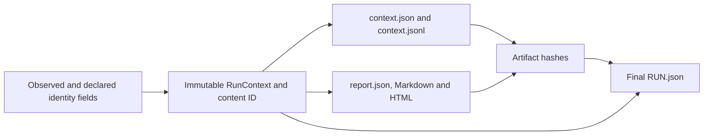

# Standalone report provenance

Status: source construction only. No audit, report render, provenance capture, code-digest helper, dependency observation, Git/provider/workflow/worker operation or verifier was executed during this construction phase. Syntax/source inspection does not establish runtime behavior, actual workflow execution, human evaluation or product acceptance.

New audit/report source carries one immutable pre-render `RunContext` alongside the frozen target evidence. A standalone JSON, Markdown or HTML report displays run identity/start, target snapshot/commit/tree/manifest, release label and observed tool-source digest, Python/dependency identities, mode/provider/model/prompt/packet identity, separate tool/workflow/trigger declarations and explicit failures/limitations. Target identity is never substituted for tool or trigger identity.

## Observation basis

`contracts.ProvenanceIdentity` stores a nullable value, `basis` and explanation `source`; the central schema owns this record. `unknown` has a null value; observed and owner-declared values are nonblank. Unknown does not become an invented version, zero cost, resolved model, Git commit or successful workflow.

| Field | What the future audit can actually record |
|---|---|
| Tool code | `observed`: existing canonical sorted package-Python source hash; unknown plus a provenance error when unavailable |
| Tool release label | Trusted source `TOOL_VERSION`, explicitly a label rather than Git/install/execution proof |
| Python | `observed`: current interpreter `sys.version` and implementation name; unavailable observations remain unknown/errors |
| Dependencies | `observed`: installed distribution metadata for the tool, Pydantic and Markdown parser where available; missing metadata stays unknown, not dependency execution proof |
| Mode | The selected audit mode, matching the run/report record; current audit service still refuses live mode |
| Provider | In replay, an explicitly declared local `fixture-replay` adapter label; this is not an observed remote provider call |
| Model and prompt | `owner_declared`: replay model label/prompt digest supplied by caller; no actual resolved live model or unseen prompt bytes are asserted |
| Packet | Unknown for standalone audits; a separate full-index utility run must not impersonate an equal-packet treatment |
| Tool/workflow/trigger revisions and trigger kind | Optional explicit owner declarations only; no Git process, target HEAD inference or environment discovery |
| Workflow run URL | Optional inert declared GitHub Actions reference; no link fetch, authentication or proof an Action ran |

`RunDeclarations` requires an actual declared owner ID when supplied, with explicit nullable tool/workflow/trigger fields. Revision values must be full lowercase SHA1/SHA256 strings; the tool does not resolve whether they exist. A workflow reference must be a plain GitHub `/actions/runs/<number>` URL with no credential/query/fragment data. It remains a literal escaped reference, never an active remote resource. Omitted fields remain unknown with an explanation. No real declarations, credentials or external accounts are supplied by this source change.

The existing `RunManifest.source_revision` compatibility field now aliases the context's owner-declared **tool** revision, never the audited target commit. `workflow_revision` and `workflow_run_url` similarly alias the declared context fields. Consumers must retain the context basis; reading an alias alone cannot establish observation. Legacy dependency string aliases use `unavailable` for null observations while the authoritative context retains the explicit unknown basis/value.

## One source-hash authority

`provenance.code_digest()` owns the exact existing `evaluation.packet.code_digest` algorithm: root at the trusted installed package, sorted `*.py` paths, refuse symlink source files, SHA256 each file's bytes, canonical JSON of `[relative_path, digest]` entries, then SHA256 that JSON. The new module's root expression changes only for its directory depth. D5's existing public function delegates to this helper; it must not retain another hashing body. No target path/root parameter, target import, Git query or process is introduced.

This is an observation of trusted package files on disk. It is not a signed execution measurement, immutable installation proof, Git commit resolution, full dependency lock or proof that every imported byte matched an immutable install. Those stronger controls remain future acceptance work. All existing evaluation code pins consume the same authority, so source changes require fresh later pinned runs rather than rewriting historical observations.

Standalone audit inputs/outputs are excluded from the trusted package directory so copied target Python files cannot be introduced into its source-hash scope by this audit. Existing snapshot path/reparse checks still use the original path chain. This does not establish that an independently installed package was immutable or free of unrelated injected files; that remains an installation/control requirement.

## Acyclic closure

Context contains run start and stable identities, never final report hashes, final manifest bytes, completion state or completion time. Its content ID hashes all its other fields. Its JSON and one-row JSONL encodings are identical canonical bytes plus one LF; their SHA256 is `RunManifest.context_digest`.

There is no edge from final RUN.json back into context or report content. The producer creates the initial manifest with the pre-render context, keeps all provenance errors, writes fresh report artifacts and then atomically replaces the final manifest after their hashes are known. Report files are flushed/fsynced before closure. Actual platform crash/directory durability still needs validation; no crash-safety result is claimed from this source.

New report artifacts include `context.json` and `context.jsonl`, and JSON embeds the same typed context. Existing claim/finding/evidence/prediction JSONL schemas stay unchanged; the context sidecar applies to that artifact set without a mixed header pretending to be a Claim. A JSONL consumer must retain the run/context association and final artifact hashes. Markdown uses source-safe dynamic fences; HTML escapes all values under the existing no-script/no-remote-resource policy. No README HTML or URL becomes active content.

## Integrity service and compatibility

The canonical `verify_report` service requires both context artifacts, compares exact canonical context bytes and hashes with the embedded report/manifest context, and binds target, run, mode, release/provider/model/prompt/packet/declared revision aliases and dependency observations. Complete reports require an observed digest matching the exact currently trusted tool source authority for replay. A context swap, missing metadata, different run/target/aliases or mismatched tool source is an integrity refusal. Inert Markdown/HTML are re-rendered from the bound report and compared without final-manifest input. Existing original-byte/query/policy replay and RawDocument coordinate handling remain the sole citation authority. Context does not replace any pointer or absence proof.

Offline self-consistency, including an `observed` basis string and a matching source hash, is not origin/authorship proof. An actor able to replace an entire unpinned run could rewrite self-consistent records. Preserve an independently trusted external manifest/artifact pin and actual workflow/install receipts for later origin claims; this change creates none of those receipts and cannot prove a declared Git/Action event occurred.

The new optional central fields default only to explicit legacy unknown (`run_context=None`, `context_digest=None`) so existing constructor signatures can be migrated. New renderer/producer/verifier behavior requires strict context; legacy artifacts lacking it are not backfilled with invented observations or accepted as provenance-complete. Regenerate them through a later authorized real audit when appropriate. Diagnostic incomplete reports may display unavailable identities and their actual pipeline errors; missing essential source observation cannot produce clean completion.

Public service extension: `audit_snapshot(snapshot_root, readme, mode, out, *, replay_path=None, prompt_digest=None, model=None, declarations: RunDeclarations | None = None) -> RunManifest`. Existing positional parameters and replay semantics stay intact. Report renderer/writer signatures remain unchanged.

Provenance helper APIs are `code_digest() -> str`; `guard_tool_paths(snapshot_root: Path, out: Path) -> None`; `capture_run_context(*, run_id, started_at, snapshot, mode, provider, model, prompt_digest, packet_digest, declarations=None) -> tuple[RunContext, list[PipelineError]]`; `validate_run_context(context) -> RunContext`; `context_bytes(context) -> bytes`; `legacy_dependencies(context) -> dict[str,str]`; `validate_report_context(report) -> RunContext`; `validate_manifest_context(manifest, report, raw_context_bytes) -> RunContext`. All shared wire models remain in contracts.py. D4 owns CLI declaration wiring; no proposed option or helper was invoked here.

Later normal-mode validation must exercise observed/declared/unknown values, unavailable source/metadata, context/target/run/provider swaps, missing JSON/JSONL metadata, raw-LF digest identity, legacy rejection, stale installed-tool closure, report-render escaping/reopening, manifest/report noncyclic hashes and failure/crash preservation. Actual Action artifacts, immutable installation/dependency evidence, live/human comparisons and independent product acceptance remain unperformed requirements.
